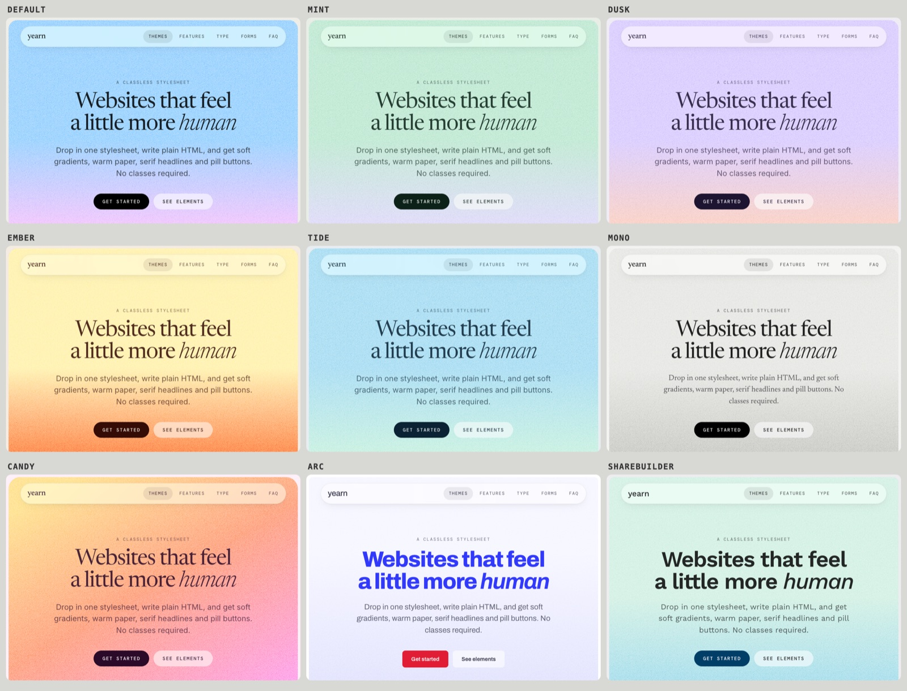

# yearn.css

A classless stylesheet for websites that feel a little more human. Write plain, semantic HTML and get soft gradients, film grain, serif headlines, pill buttons, dark mode and nine swappable themes. No classes required.

**[Live demo →](https://immannino.github.io/yearn.css/)**



## Quick start

Add one line to your `<head>`:

```html
<link rel="stylesheet" href="https://cdn.jsdelivr.net/gh/immannino/yearn.css@0.1.0/dist/yearn.min.css">
```

Or download [`yearn.css`](yearn.css) and link it locally. Then write HTML:

```html
<body>
  <header>
    <nav>
      <a href="/"><strong>My site</strong></a>
      <ul><li><a href="/about">About</a></li></ul>
    </nav>
    <h1>Hello, <em>world</em></h1>
    <p>A sentence about what this is.</p>
    <p><a href="/start" role="button">Get started</a> <a href="/docs" role="button">Read the docs</a></p>
  </header>
  <main>
    <section>
      <h2>Features</h2>
      <article><h3>Fast</h3><p>…</p></article>
      <article><h3>Friendly</h3><p>…</p></article>
    </section>
  </main>
  <footer><p>© 2026 Me</p></footer>
</body>
```

## What plain HTML turns into

| You write | You get |
|---|---|
| `body > header` | An inset, rounded hero with a grainy gradient |
| `nav` inside the hero, or `body > nav` | A frosted-glass pill nav (`body > nav` sticks to the top) |
| `section` with two or more `<article>`s | A responsive card grid that breaks out to a wider column |
| `<article>` | A card; a first-child `` bleeds to its edges |
| `<aside>` | A tinted callout in the accent color |
| `body > footer` | An inset dark footer card |
| `a role="button"` | A link styled as a button |
| A button after another button | A secondary button |
| `h5`, `h6`, or a `<p>` before the heading in an `<hgroup>` | Small uppercase mono "eyebrow" labels |
| `<form role="search">` or `<search><form>` | A single-line pill search bar |
| `<input type="checkbox" role="switch">` | A toggle switch |
| `<menu>` | A row of buttons or links |
| `<details>`, `<dialog>` | An accordion; a modal with a blurred backdrop |

Everything else (typography, lists, quotes, code, tables, forms, progress, meter, figures, `<kbd>`, `<mark>`) is styled too. See the [demo](https://immannino.github.io/yearn.css/) for every element.

## Options

These are attributes, not classes, and all of them are optional.

| Attribute | Values | Effect |
|---|---|---|
| `data-theme` on `<html>` | `light`, `dark` | Force a mode. Without it, yearn follows the OS. |
| `data-gradient` on `<html>` or any element | `cotton-candy`, `creamsicle`, `grapefruit`, `sunshine`, `midnight`, `plain` | Hero gradient. On any other element it becomes a grainy gradient surface. |
| `data-accent` on `<html>` | `blue`, `pink`, `red`, `orange`, `brown` | Accent color for links, focus rings and controls. |

## Themes

A theme is a small stylesheet loaded **after** yearn.css:

```html
<link rel="stylesheet" href="https://cdn.jsdelivr.net/gh/immannino/yearn.css@0.1.0/dist/yearn.min.css">
<link rel="stylesheet" href="https://cdn.jsdelivr.net/gh/immannino/yearn.css@0.1.0/dist/themes/dusk.min.css">
```

| Theme | Feel |
|---|---|
| *(default)* | Warm off-white paper, black ink, electric blue |
| `mint` | Sage paper, forest ink, green accent |
| `dusk` | Lavender paper, plum ink, lilac-to-peach hero |
| `ember` | Toasted cream, espresso ink, signal red |
| `tide` | Cool slate, navy ink, teal and seafoam |
| `mono` | Newsprint greys, black and white, serif body text |
| `candy` | Pink paper, magenta accent, loud diagonal hero, rounder corners |
| `arc` | After the Arc Resource Center: heavy blue headlines, red buttons, grainy color blocks, edge-to-edge blue footer |
| `sharebuilder` | ShareBuilder 401k brand: navy, green and sky blue, Work Sans |

Every theme has light and dark variants and passes WCAG AA contrast in both.

### Make your own

Copy [`themes/_template.css`](themes/_template.css). It lists every variable with its default. A theme is one `:root` block, and each color is written as `light-dark(<light>, <dark>)`:

```css
:root {
  --y-bg: light-dark(#efecf5, #16141c);       /* page */
  --y-surface: light-dark(#ffffff, #201d28);  /* cards, inputs */
  --y-fg: light-dark(#1c1430, #ece8f5);       /* text; muted shades are mixed from it */
  --y-accent: light-dark(#6436f0, #a98bff);   /* links, focus, controls */
  --y-ink: light-dark(#1c1430, #ece8f5);      /* primary buttons */
  --y-on-ink: light-dark(#efecf5, #16141c);
  --y-hero-from: light-dark(#d8cbff, #2a1a4a);
  --y-hero-to: light-dark(#ffcfb8, #b4527a);
}
```

You only set base colors. Text shades, fills, borders, glass and focus rings are derived from them. Themes can also change fonts, heading weight and color, button style (`--y-button-case: none` for sentence case), corner radii, grain strength, the footer, or replace the hero with any image via `--y-hero`.

Check a new theme with `npm run contrast -- my-theme`.

## Fonts

`yearn.css` and `dist/yearn.min.css` load [Inter](https://rsms.me/inter/), [Newsreader](https://fonts.google.com/specimen/Newsreader) and [DM Mono](https://fonts.google.com/specimen/DM+Mono) from Google Fonts. Two ways to make that faster:

- **Preconnect**, so the font request starts sooner:
  ```html
  <link rel="preconnect" href="https://fonts.googleapis.com">
  <link rel="preconnect" href="https://fonts.gstatic.com" crossorigin>
  ```
- **Skip Google Fonts entirely** with `dist/yearn.core.min.css`. Self-host the fonts, or let it fall back to system fonts (Georgia/Palatino for headings, the system UI font for body text).

To use other fonts, set `--y-font-sans`, `--y-font-serif` and `--y-font-mono`.

## Browser support

Chrome and Edge 123+, Safari 17.5+, Firefox 121+ (all released 2024). yearn relies on `light-dark()`, `color-mix()` and `:has()`.

Older browsers that lack `light-dark()` get the default light palette, and themes and dark mode are skipped there. Very old browsers will render without colors.

## Accessibility

- All themes pass WCAG AA contrast for text, links, buttons and code, in light and dark (`npm run contrast`).
- Keyboard focus gets a visible dotted ring.
- `prefers-reduced-motion` turns off transitions and animations.
- Spacing uses logical properties, so right-to-left pages (`dir="rtl"`) lay out correctly.
- Printing gives plain black-on-white pages with link URLs shown.

## Development

```sh
npm install
npm run build      # writes minified files to dist/
npm run contrast   # WCAG contrast audit across every theme
```

Open `index.html` in a browser to see the demo. `index.html?theme=dusk&mode=dark` opens it with a theme and mode preselected.

`dist/` is committed so the jsDelivr links work. Run `npm run build` before tagging a release.

## Credits

The look is inspired by [The Browser Company](https://thebrowser.company/) and the [Arc Resource Center](https://resources.arc.net/). yearn.css is an unofficial fan project and is not affiliated with or endorsed by The Browser Company. "Arc" is their trademark.

## License

[MIT](LICENSE)
